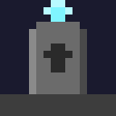

### SoulGraves

is the grave system of your project: it intercepts player deaths, places a gravestone (optionally automatically inside a configurable graveyard region), and stores the player's inventory, XP, and soul in a soul orb that is bound to that grave. It works standalone and knows nothing about limbo or rituals — it simply exposes an API and events that other plugins can use to access graves.

 

## Plugin Dependencies

| Plugin | Required? | Purpose |
|---|---|---|
| **Nexo** / **ItemsAdder** / **Oraxen** | Optional (one of them) | Custom gravestone blocks & soul orb items |
| **WorldGuard** | Optional | Manage graveyard regions via WorldGuard regions |
| **Database** (local SQLite / external MySQL) | Optional | Persistence of graves & regions (SQLite requires no installation) |